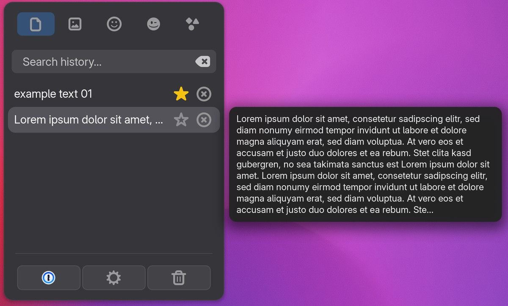
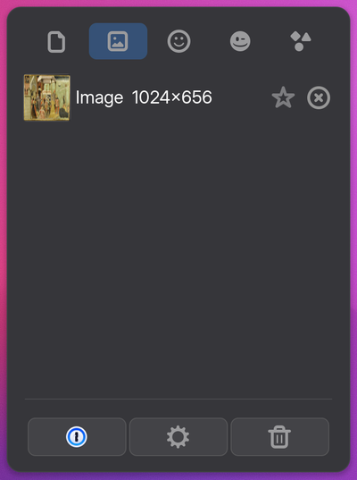
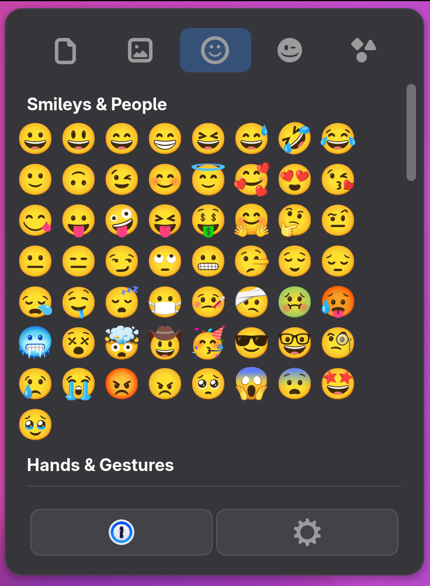
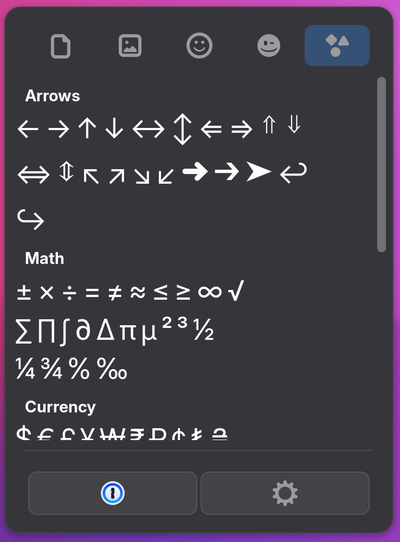
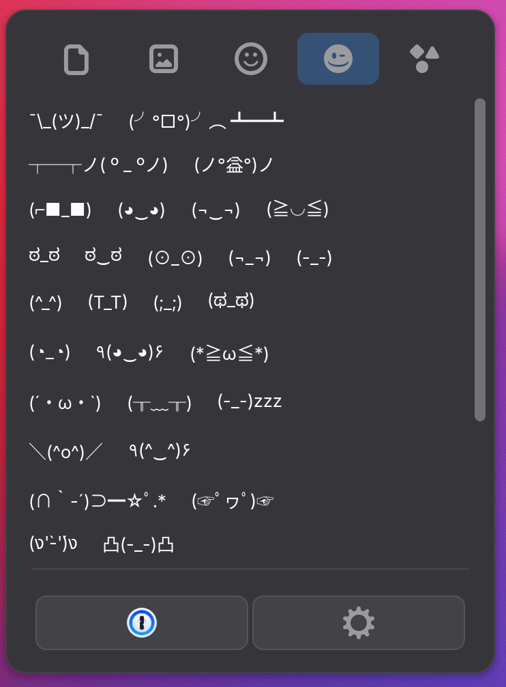
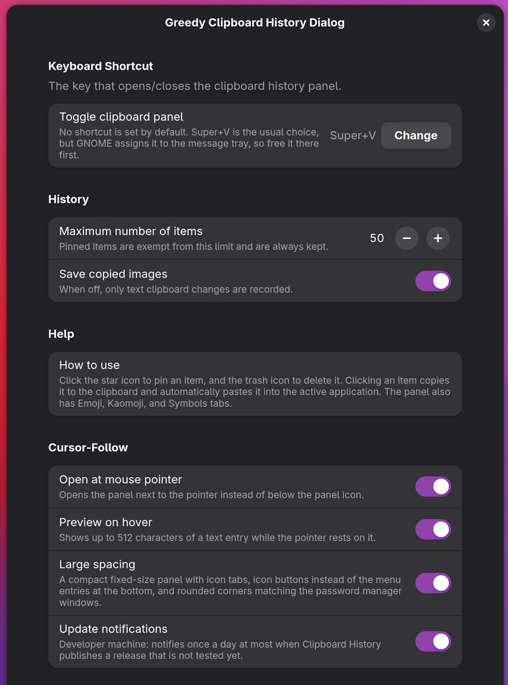
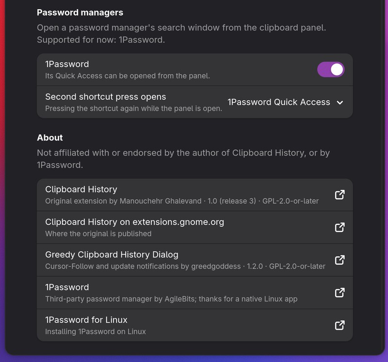
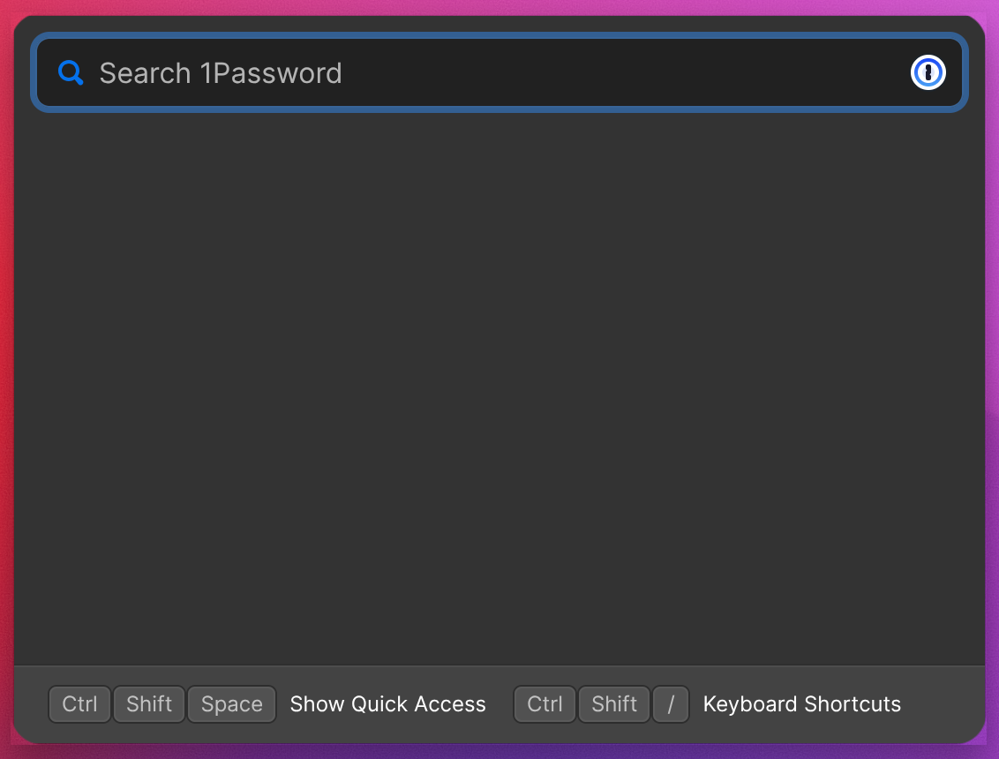

# greedy-clipboard-history-dialog


**Clipboard History for GNOME Shell, with an option to open the panel at the mouse pointer.**

<p align="center">
  
</p>

An independently maintained GNOME Shell extension based on
[Clipboard History](https://github.com/M-ghalevand/gnome-shell-extension-clipboard-history)
by Manouchehr Ghalevand. It adds a **Cursor-Follow** section to the
preferences:

- **Open at mouse pointer:** the panel opens to the right of the pointer
  with its bottom edge level with it, or to the left when there is no room
  on the right.
- **Private history folder** (on by default): keeps the folder that
  stores your clipboard history closed to other user accounts; see
  [private history folder](docs/private-history.md).
- **Clear unpinned entries at login** (off by default): each login starts
  with only your pinned entries; see
  [clear at login](docs/clear-at-login.md).
- **Preview on hover:** resting the pointer on a text entry shows up to
  512 characters of it next to the panel; see
  [hover preview](docs/hover-preview.md).
- **Password managers** (optional, not installed by default): open a
  password manager's search window from the panel, with the second press of
  the shortcut or, in Large spacing, a button. Supported for now:
  [1Password](https://1password.com/) and its Quick Access window. Install
  it with `./install.sh --with-password-managers`; see
  [password managers](docs/password-managers.md). Thanks to 1Password for a
  native Linux app.
- **Gestures** (optional, not installed by default): a three-finger tap on
  the touchscreen opens the panel at the center of the fingers, a
  three-finger hold on the touchpad at the pointer; each switchable, with a
  blocklist for drawing apps. Install them with
  `./install.sh --with-gestures`; see [gestures](docs/gestures.md).
- **Large spacing** (optional, not installed by default): a compact
  fixed-size panel with icon tabs, icon buttons (password managers,
  settings, clear) instead of the menu entries at the bottom, and rounded
  corners shared with the password manager windows. Install it with
  `./install.sh --with-large-spacing`; see [large spacing](docs/large-spacing.md).
- **Update notifications:** a notification when there is an update to
  install; see [update notifications](docs/update-notifications.md).

This repository contains the additions and the tooling to build and maintain
them against tested releases of Clipboard History; it does not keep a
modified copy of the original source. `./install.sh` downloads a tested
release and adds them without editing the original code; see
[how it works](docs/cursor-follow.md).

## Screenshots

On GNOME Shell 51, with Large spacing, the password manager integration and
the hover preview switched on. The panel with a hover preview is shown at the
top.

<p align="center">
  
  
  
  
  <br><sub>Images · Emoji · Symbols · Kaomoji</sub>
</p>

<p align="center">
  
  
  
  <br><sub>Preferences · Password managers and About · 1Password Quick Access</sub>
</p>

## Relationship with Clipboard History

- Built from releases of Clipboard History; all of its functionality is kept
  as released.
- The additions are maintained here, independently.
- Installed under its own ID (`greedy-clipboard-history-dialog@greedgoddess`),
  with its own settings and clipboard history; the two never share data.
- **Not affiliated with or endorsed by the original author.** Attribution and
  licensing: [NOTICE](NOTICE).

**Where to report problems:**

| Problem | Where |
| --- | --- |
| Open at mouse pointer, update notifications, building, installing, GNOME Shell compatibility | [This repository](https://github.com/greedgoddess/greedy-clipboard-history-dialog/issues) |
| History, search, pinning, emoji, pasting: anything that also happens with the original | [Clipboard History](https://github.com/M-ghalevand/gnome-shell-extension-clipboard-history/issues) |
| Not sure | Here first; check whether the original shows the same problem |

Maintained for the author's own use and shared as is: issues are welcome,
fixes are best effort.


Considerations about the original's code, documented rather than patched:
[appendix](docs/upstream-considerations.md).

## Install

```bash
git clone https://github.com/greedgoddess/greedy-clipboard-history-dialog.git
cd greedy-clipboard-history-dialog
./install.sh
```

With SSH set up for GitHub, `git@github.com:greedgoddess/greedy-clipboard-history-dialog.git`
works the same. This installs the latest state of `main`; for the latest
release instead, add `--branch` and its tag (see
[Releases](https://github.com/greedgoddess/greedy-clipboard-history-dialog/releases)).
`install.sh` builds first if needed. Log out and back in, then check with
`./verify.sh`. The first install switches **Open at mouse pointer** and
**Update notifications** on, and **Private history folder** is on by
default; everything else starts off. The preferences
can change all of them.

**From Clipboard History or an earlier version of this project:** run
`./uninstall-previous-version.sh` before `./install.sh`. It copies your
history and settings over, then removes the old extension.

**Optional features:** `./install.sh --with-password-managers` adds the
password manager integration, `--with-gestures` the gestures, and
`--with-large-spacing` large spacing;
`--without-…` removes them. All are left out by default, and each is kept
by later installs. (`--with-1password` is the older name for the first.)

**Update:** `./update.sh` (pulls this repository, builds the newest tested
release, installs), then log out and back in.

**Uninstall:** `./uninstall.sh` keeps history and settings; add `--purge`
to delete them too.

## Compatibility

### Tested releases

`./build.sh` builds the newest of these that supports the running GNOME
Shell, and refuses a download that differs from what was tested. A build of
any other release is marked untested, and `install.sh` asks before
installing it.

<!-- tested-releases:start -->
| Release | GNOME Shell (release) | Tested on | Manual checks | Date |
| --- | --- | --- | --- | --- |
| 1.0 (3) | 46, 47, 48, 49, 50, 51 | GNOME Shell 51.1 | 7 of 7 passed | 2026-11-09 |
<!-- tested-releases:end -->

### What is verified where

| What | Where | How |
| --- | --- | --- |
| Source syntax, ShellCheck, unit tests, build integrity | GitHub Actions (CI), on every push | Automatically; a green CI run means only this |
| The extension loads in GNOME Shell without errors | A GNOME desktop | Smoke test; required before a release is recorded as tested |
| Opens at the pointer, flips at screen edges | A GNOME desktop | By hand, with the [testing checklist](docs/cursor-follow.md#testing) |
| Large spacing: taller tabs, icon buttons that work | A GNOME desktop | By hand, with [its checklist](docs/large-spacing.md#testing) |
| Password managers: switches to 1Password Quick Access, where the panel was | A GNOME desktop with 1Password | By hand, with [its checklist](docs/password-managers.md#testing) |
| Hover preview | A GNOME desktop | By hand, with [its checklist](docs/hover-preview.md#testing) |

### Verified GNOME Shell versions

A release lists the GNOME Shell versions the *original* supports. This
project is verified only where marked here:

| GNOME Shell | Builds | Activates (smoke test) | Opens at pointer | Flips at screen edge | Password managers: 1Password (optional) | Large spacing (optional) | Hover preview |
| --- | --- | --- | --- | --- | --- | --- | --- |
| 51 | yes | yes | yes, by hand | yes, by hand | yes, by hand (1.2.0) | yes, by hand (1.2.0) | yes, by hand (1.2.0) |
| 46–50 | not tested | not tested | not tested | not tested | not tested | not tested | not tested |

The smoke test needs GNOME and may fail on headless systems; it runs on a
GNOME desktop, not in CI. The manual checks are
in [the testing checklist](docs/cursor-follow.md#testing).

## Versions

This project's version is in [`VERSION`](VERSION) and the
[changelog](CHANGELOG.md); releases are tagged `vX.Y.Z` on GitHub. The
installed extension shows both versions, for example
`1.4.0 (Clipboard History 1.0, release 3)`; `build/BUILD-INFO` and the
`build-info.json` inside each build record the full provenance.

## Development

See [CONTRIBUTING.md](CONTRIBUTING.md): developer machines
(`./install.sh --dev`), testing, and adding a tested release with
`./update-test-and-push.sh --push`, which also asks for and records the
[manual checks](CONTRIBUTING.md#manual-checks). Security issues: [SECURITY.md](SECURITY.md).

The additions were written largely by an AI assistant (Claude, by
Anthropic), directed and tested by the author.

## Troubleshooting

| Problem | Fix |
| --- | --- |
| No change after installing or updating | Log out and back in |
| Build: no tested release for this GNOME Shell | Wait for one, or `./build.sh --latest` and test it |
| Build: release differs from the tested one | The download changed; a developer machine re-tests it with `./update-test-and-push.sh --force --push` |
| Build warns, or the panel opens below its icon | See [what can break](docs/cursor-follow.md#what-can-break-and-what-happens-then) |
| Two clipboard icons in the panel | The old extension is enabled again; run `./uninstall-previous-version.sh` |
| No update notifications | Check Preferences → Cursor-Follow, and the last check in `./verify.sh` |
| Anything else | `journalctl -f -o cat /usr/bin/gnome-shell` |

## License

GPL-2.0-or-later, like Clipboard History; see [NOTICE](NOTICE). Each build
includes the original's `LICENSE` and copyright notices unchanged.
