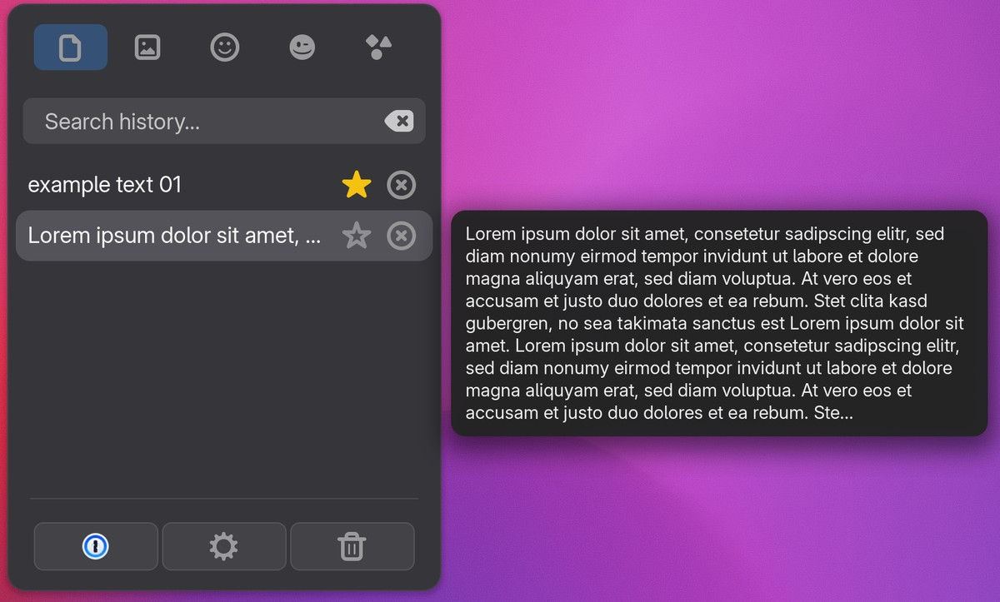
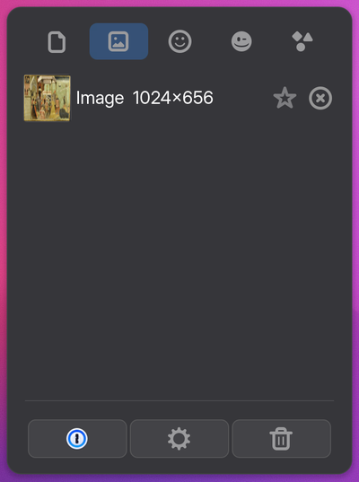
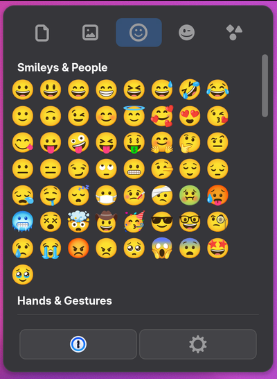
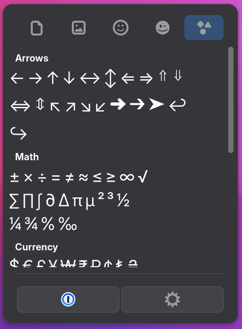
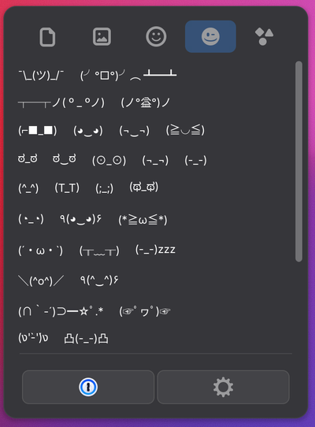

# Large spacing

An optional visual mode with larger touch targets, for touch screens. It is
**not installed by default**: see [installing it](#large-spacing-install-option). Once installed
and switched on (Preferences → Cursor-Follow → **Large spacing**):

- the panel has one fixed size, the same on every tab;
- the tab bar at the top shows [icons](#large-spacing-tab-icons) instead of the
  names Text, Images, Emoji, Kaomoji and Symbols, in the same compact
  format as the button row at the bottom;
- the clipboard entries are compact, with little vertical padding;
- the panel has [rounded corners](#large-spacing-corners) with a 15 px
  radius, and with the password manager integration installed, the search
  windows get the same corners, so both match;
- the menu entries at the bottom are replaced by a row of icon buttons:
  optional entries first, then **settings** (gear) and **clear** (trash
  can). With the [password manager integration](password-managers.md)
  installed, each enabled password manager gets a button first, with its app
  icon; see [password manager buttons](#large-spacing-provider-buttons).
  For 1Password it opens Quick
  Access the same way as the second press of the shortcut.

<p align="center">
  
</p>
<p align="center">
  
  
  
  
  <br><sub>Images · Emoji · Symbols · Kaomoji</sub>
</p>

The buttons trigger the original entries, so settings and clearing behave
exactly as before. As in the original design, the trash can only shows when
"Clear (except pinned)" would: the original hides it when there is nothing
to clear (everything pinned, or the Emoji, Kaomoji and Symbols tabs). The
bottom buttons have a background and
outline of their own, to set them apart from the panel.

The code is in `feature/largeSpacing.js` and `feature/largeSpacing.css`; each
section starts with a tag:

```bash
grep -rn "\[large-spacing:" feature/ install.sh
```

<a id="large-spacing-install-option"></a>
## `large-spacing:install-option`

```bash
./install.sh --with-large-spacing      # include large spacing
./install.sh --without-large-spacing   # leave it out again (the default)
```

Large spacing was called touch mode before version 1.2.0 was released;
`install.sh` carries an earlier touch-mode choice and switch over.

Without `--with-large-spacing`, `install.sh` leaves `largeSpacing.js` and
`largeSpacing.css` out of the installed copy and records `largeSpacing: false` in
its `features.js`. The choice is independent of the password manager integration,
kept by later installs and updates until changed, and removing large spacing
also switches its setting off. `./verify.sh` shows whether it is installed.

<a id="large-spacing-setting"></a>
## `large-spacing:setting`

Boolean key `large-spacing` in `feature/settings-keys.xml`, default `false`.
It applies at once, without reopening anything.

<a id="large-spacing-preference"></a>
## `large-spacing:preference`

The **Large spacing** switch in the Cursor-Follow group, shown only when large
spacing is installed.

<a id="large-spacing-entry-point"></a>
## `large-spacing:entry-point`

When `features.js` says large spacing is installed, `feature/extension.js` loads
`largeSpacing.js` with a dynamic `import()` and creates `LargeSpacing` with the
panel menu, the settings, the stylesheet, and a way to reach the password manager
integration if it is loaded. It is destroyed on `disable()`.

<a id="large-spacing-install"></a>
## `large-spacing:install`

`LargeSpacing` loads `largeSpacing.css` into GNOME Shell's theme (unloaded again on
`disable()`) and follows the `large-spacing` and `password-managers`
settings.

<a id="large-spacing-find-actions"></a>
## `large-spacing:find-actions`

`findMenuActions()` finds the original's two entries among the menu's items
by their labels, "Extension Settings…" and "Clear (except pinned)". If a
release renames them, large spacing stays inactive and logs a warning, and
`build.sh` warns already when building that release.

<a id="large-spacing-button-order"></a>
## `large-spacing:button-order`

`orderButtons()`: optional entries first (the enabled password managers), then
settings, then clear.

<a id="large-spacing-apply"></a>
<a id="large-spacing-clear-keeps-open"></a>
## `large-spacing:apply`

Takes the two original entries out of the menu, keeping them and their
places, puts one row of buttons where the first of them was, and applies the
[layout](#large-spacing-layout). Each button
calls `activate()` on its original entry, which runs the original's own
action, as clicking the entry did; the gear closes the panel, the trash can
keeps it open (`large-spacing:clear-keeps-open`). The trash can follows
the visibility the original gives its "Clear" entry.

<a id="large-spacing-tab-icons"></a>
## `large-spacing:tab-icons`

`TAB_ICONS` in `feature/largeSpacing.js` gives each tab an icon, recognised by
the tab's name. Each has fallbacks, and the first one the icon theme has is
used:

| Tab | Icons, in order of preference |
| --- | --- |
| Text | `text-x-generic-symbolic`, `format-text-plaintext-symbolic`, `edit-paste-symbolic` |
| Images | `image-x-generic-symbolic`, `camera-photo-symbolic` |
| Emoji | `emoji-people-symbolic`, `face-smile-symbolic` |
| Kaomoji | `face-wink-symbolic`, `face-smile-big-symbolic`, `emoji-body-symbolic` |
| Symbols | `emoji-symbols-symbolic`, `insert-text-symbolic` |

The name stays as the tab's accessible name, for screen readers, and comes
back as the label when large spacing is switched off. A tab with a name not in
the table keeps its text.

<a id="large-spacing-corners"></a>
## `large-spacing:corners`

While Large spacing is on, the panel's corner radius is 15 px, set in
`feature/largeSpacing.css`. A GNOME panel menu is an invisible outer box
around the visible inner box; the radius is set on both
(`-arrow-border-radius` on the outer one, `border-radius` on the inner one),
so whichever the theme draws gets it. The radius sits between GNOME's 12 px
windows and the panel's usual theme radius, closer to the former.

With the password manager integration installed, a search window such as
1Password Quick Access gets rounded corners too, drawn by GNOME Shell without
changing the password manager; see
[rounded corners](password-managers.md#password-manager-rounded-corners).
Its radius, `CORNER_RADIUS` in `feature/roundedCorners.js`, is 3 px larger
than the panel's (`PANEL_CORNER_RADIUS`): the panel's outline and shadow make
its corners look rounder than a bare window's with the same radius, so this
way both look the same. A test keeps `PANEL_CORNER_RADIUS` equal to the
stylesheet. With Large spacing off, the panel has the theme's radius and
the search windows square corners.

<a id="large-spacing-provider-buttons"></a>
<a id="large-spacing-provider-indicator"></a>
## `large-spacing:provider-buttons`, `large-spacing:provider-indicator`

With the [password manager integration](password-managers.md) installed,
each enabled password manager gets a button at the start of the bottom row,
with its app icon (looked up through GNOME Shell's app registry, from either
its native package or its Flatpak). Tapping it opens the password manager's
search window where the panel was, like the second press of the shortcut.

Whether each password manager is running is checked whenever the panel opens.
While one is not running, its icon is greyed out (colours removed and faded)
and a small red dot shows in the button's corner. This is an indicator only: the button stays clickable,
and the shortcut keeps working; both then show a notification that the app is
not running.

<a id="large-spacing-rows"></a>
## `large-spacing:rows`

The tab bar at the top and the button row at the bottom share one format in
`feature/largeSpacing.css`: the same row margins and spacing, and buttons of
the same height, corners and hover colours, so the two look alike and take
little height. The tabs keep the original's highlight for the selected tab.

<a id="large-spacing-layout"></a>
<a id="large-spacing-emoji-rows"></a>
## `large-spacing:layout`

All sizes are fixed in `feature/largeSpacing.css`; nothing is measured or
adjusted while the extension runs. Large spacing adds the class
`greedy-large-spacing` to the panel's box, which gives it:

| What | Size |
| --- | --- |
| Panel | 345 × 472 px, the same on every tab; the list takes all height the other parts leave |
| Font | normal size (`font-size: 1em`) |
| Tab bar and button row | the same format: buttons 38 px tall (24 px icons, 7 px above and below), 8 px corners, 3 px apart, same hover colours |
| Clipboard entries | text 1.25 × normal; 5 px above and below it, 10 px at the sides; 24 px pin and delete icons, the delete icon in the same grey as the star when off |
| Search field | nearly as wide as the list below (its row loses its side padding; 6 px margin at each side); text the same size as the list's (1.25 em), 24 px clear icon |
| Emoji and symbols | 26 px, 1.3 × the original: the largest that fits the original's 8 (symbols 10) per row; natural width, lined up from the left in each category instead of spread over the row |
| Kaomoji | 13 px |
| Corner radius | panel 15 px; password manager search windows 18 px, which looks the same |

The list takes all the height the other parts leave. On tabs without the
search row, the list gets that row's height, so the panel keeps its size.
To change a size, change it in `largeSpacing.css` and reinstall.

<a id="large-spacing-unapply"></a>
## `large-spacing:unapply`

Switching large spacing off removes the row, puts the original entries back
where they were, and returns the panel to the original's sizes.

<a id="large-spacing-cleanup"></a>
## `large-spacing:cleanup`

On `disable()`: undoes everything above and unloads the stylesheet.

## Testing

`tests/js/largeSpacing.test.mjs` covers finding the entries, the button order,
the password manager buttons and their indicator, the buttons
triggering the original entries, the trash can following the original's
visibility, the tab icons, the layout being applied, and putting everything
back exactly.
The smoke test loads large spacing switched on.

By hand, on a GNOME desktop (with a touch screen if available):

1. Large spacing off: the panel looks exactly as before.
2. Switch it on: icons in the tab bar, compact entries; at the bottom, gear
   and trash can buttons replace the two entries. Switch between all five
   tabs: the panel keeps its size, and each tab shows its icon.
3. Tap the gear: the preferences open. Tap the trash can: the history is
   cleared except pinned entries, as before. With nothing to clear, and on
   the Emoji, Kaomoji and Symbols tabs, the trash can is hidden.
4. On the Emoji and Symbols tabs, every row fits the panel without being cut
   off on the right, and the emoji line up from the left in each category.
5. With the password manager integration installed and 1Password enabled: a
   1Password button comes first and opens Quick Access where the panel was.
   With 1Password not running, its icon is greyed out with a small red dot,
   and tapping it still works (a notification says it is not running).
6. The panel has rounded corners; with the password manager integration, Quick
   Access has the same ones.
7. Switch large spacing off: everything is back as in step 1, and Quick
   Access has square corners again (the next time it opens).
