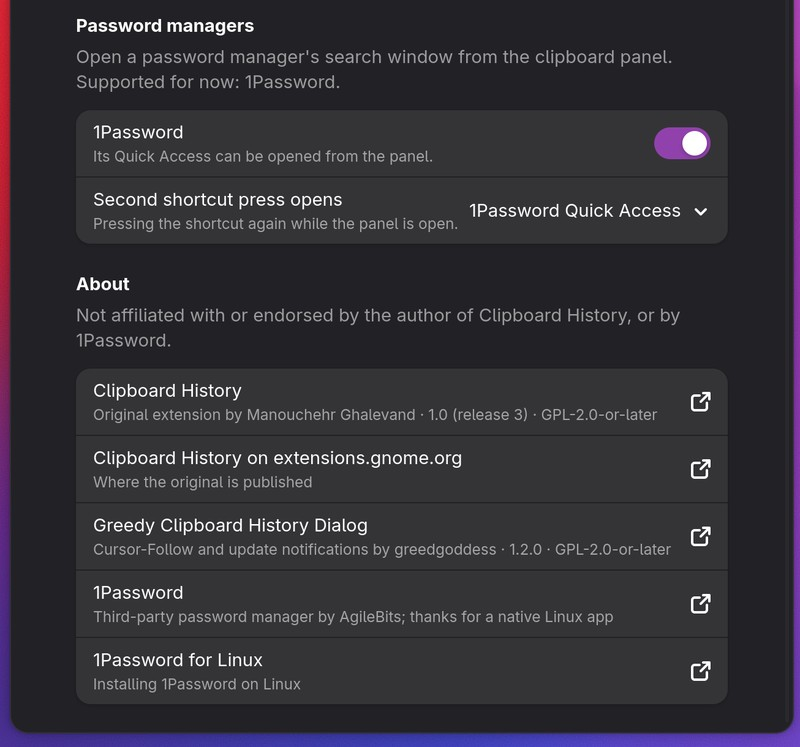
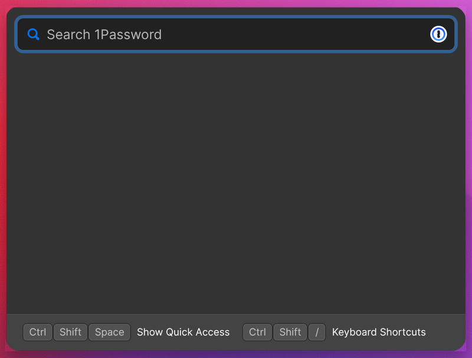

# Password managers

An optional integration that opens a password manager's search window from
the clipboard panel. It is **not installed by default**: see
[installing it](#password-manager-install). **1Password**, with its Quick
Access window, is the only supported password manager for now; the code is
written so that others can be added as entries in one list.

Once installed, Preferences → **Password managers** has:

- one switch per supported password manager. Any number can be on, or all of
  them. A switch can only be turned on while that app is installed and
  running;
- **Second shortcut press opens**: which of the enabled password managers the
  clipboard shortcut opens when pressed again while the panel is open, or
  nothing (the second press then closes the panel, as in the original).

With [Large spacing](large-spacing.md#large-spacing-provider-buttons), each
enabled password manager also gets a button with its app icon at the bottom
of the panel.

<p align="center">
  
  
  <br><sub>Password managers and About · 1Password Quick Access</sub>
</p>

Only one of the panel and a search window can be open at a time: GNOME closes
a panel menu as soon as another window takes the keyboard, and a search
window such as Quick Access hides as soon as it loses it. So the panel comes
first, and the second press, or a button, switches.

A thank-you to 1Password for offering a native Linux app, with a documented
command for opening Quick Access on Wayland: that is what makes this
integration possible. This project is not affiliated with or endorsed by
1Password, or by any other password manager.

**1Password links:**
[1Password](https://1password.com/) ·
[Install 1Password on Linux](https://support.1password.com/install-linux/) ·
[Keyboard shortcuts on Linux, including Wayland](https://support.1password.com/keyboard-shortcuts/?linux)

The code is in `feature/passwordManagers.js` (the supported password managers
and finding them), `feature/passwordManagerSwitch.js` (the shortcut and
opening a search window) and `feature/roundedCorners.js`; each section starts
with a tag:

```bash
grep -rn "\[password-manager:" feature/ install.sh
```

<a id="password-manager-install"></a>
## `password-manager:install`

```bash
./install.sh --with-password-managers      # include the integration
./install.sh --without-password-managers   # leave it out again (the default)
```

`--with-1password` and `--without-1password` are older names for the same
flags and still work.

Without the flag, `install.sh` leaves `passwordManagerSwitch.js`,
`passwordManagers.js` and `roundedCorners.js` out of the installed copy and
records `passwordManagers: false` in its `features.js`, so no password manager
code is installed at all: no shortcut takeover, no preferences group, no
buttons, no links in About. The choice is kept by later installs and updates
until changed with the other flag; removing the integration also switches
every password manager off.

Before version 1.2.0 this was the 1Password integration, with one switch.
`install.sh` carries it over: with that switch on, 1Password is enabled and
opened by the second shortcut press. `./verify.sh` shows what is enabled.

<a id="password-manager-providers"></a>
## `password-manager:providers`

`PROVIDERS` in `feature/passwordManagers.js` has one entry per supported
password manager: its name and the name of its search window; where its
program can be (on `PATH`, at a fixed path, or as a Flatpak); the arguments
that open its search window; its process name, to check that it runs; the
class or app ID of its windows; its desktop file IDs, for its icon; and the
links shown in About. Adding a password manager means adding an entry; the
preferences, the shortcut, the buttons and About pick it up from there.

For 1Password: `1password` on `PATH`, `/opt/1Password/1password`, or the
Flatpak `com.onepassword.OnePassword`; `--quick-access`, as 1Password
[documents for Wayland](https://support.1password.com/keyboard-shortcuts/?linux);
process `1password`; windows of class `1Password` (XWayland) or app ID
`com.onepassword.OnePassword` (Wayland, Flatpak).

<a id="password-manager-detection"></a>
## `password-manager:detection`

`findCommand()` finds a password manager's program, the first place that has
it. It counts as running when `pgrep -x` finds its process: its search window
only opens while the app runs, usually in the background. Without `pgrep`
this cannot be checked, and the password manager counts as not available.
The extension and the preferences share this code.

<a id="password-manager-settings"></a>
<a id="password-manager-enabled"></a>
## `password-manager:settings`

Keys in `feature/settings-keys.xml`: `password-managers`, the IDs of the
enabled password managers (empty by default), and `shortcut-password-manager`,
the ID the second shortcut press opens (empty: nothing). The installer does
not enable anything. `enabledProviders()` turns the IDs into password
managers, in the order of `PROVIDERS`.

<a id="password-manager-preference"></a>
<a id="password-manager-shortcut-preference"></a>
## `password-manager:preference`

The **Password managers** group in the preferences: a switch per supported
password manager, which checks availability when the preferences open. If the
app is missing or not running, the switch cannot be turned on, its subtitle
says why, and **Check again** looks once more; it can always be turned off.
Below, **Second shortcut press opens** lists "Nothing" and the enabled
password managers.

<a id="password-manager-entry-point"></a>
## `password-manager:entry-point`

When `features.js` says the integration is installed, `feature/extension.js`
loads `passwordManagerSwitch.js` with a dynamic `import()` after the original
has built its panel, and creates the `PasswordManagerSwitch`; it is destroyed
first on `disable()`. The preferences load `passwordManagers.js` the same way.

<a id="password-manager-shortcut"></a>
<a id="password-manager-shortcut-action"></a>
## `password-manager:shortcut`, `password-manager:shortcut-action`

The original registers its shortcut as the keybinding `toggle-shortcut`.
`PasswordManagerSwitch` removes it and registers it again, with the same
setting, flags and action modes (normal, overview, and while a menu is open),
but its own handler. `shortcutAction()` decides: if the password manager
chosen for the shortcut is enabled and the panel is open, switch to it;
otherwise toggle the panel, exactly like the original. The shortcut works the
same whether that password manager is running or not: when it is not, a
notification says so.

This depends on the original's keybinding name; `build.sh` warns if a release
no longer has `toggle-shortcut`.

<a id="password-manager-switch"></a>
## `password-manager:switch`

Notes where the pointer and the visible panel are, closes the panel, and
checks that the password manager is installed and running; if not, a
notification says why. Then it starts waiting for one of its windows and runs
its command.

The first window of that password manager shown within 15 seconds is moved
into place. Each new window is checked when it is shown, not when it is
created: at creation it has no class or app ID yet. For 1.5 seconds after
that, if the app moves or resizes its window itself, it is put back; after
that you can move it freely. 1Password's forums report that Quick Access can
take a few seconds to appear, and on some systems only appears on the second
call; this code does not work around either.

<a id="password-manager-placement"></a>
<a id="password-manager-anchor"></a>
## `password-manager:anchor`, `password-manager:placement`

The search window goes where the panel was, against the same corner, so both
sit at the same distance from the pointer. A GNOME panel menu is an invisible
outer box around the visible panel, so the visible panel's position is used,
not the pointer: `panelAnchor()` takes the visible panel's bottom-left corner
when the panel is to the right of the pointer, and its bottom-right corner
when it was flipped to the left. `placeWindow()` then puts the window's
matching corner there, and moves it only as far as needed to stay inside the
monitor's work area, for example near the top of the screen.

Without an open panel, the window goes with its bottom-left corner at the
pointer, and to the left of it when there is no room on the right.

<a id="password-manager-rounded-corners"></a>
<a id="password-manager-shader-api"></a>
<a id="password-manager-corner-bounds"></a>
## `password-manager:rounded-corners`

`feature/roundedCorners.js`. Rounded corners are part of
[Large spacing](large-spacing.md#large-spacing-corners): while Large spacing
is installed and on, the search window gets rounded corners that match the
clipboard panel's: 18 px, slightly more than the panel's 15 px, because the
panel's outline makes its corners look rounder. There is no separate switch.

The password manager is not changed or asked for anything: GNOME Shell draws
every window itself, and a small shader effect on the search window, as GNOME
Shell draws it, makes the pixels outside the rounded corners transparent.
`cornerBounds()` finds the window's visible frame inside what GNOME Shell
draws, which can include invisible borders, so only the frame's four corners
are cut. The effect follows size changes and is removed when the window
closes or the extension is disabled.

GNOME Shell 51 removed the shader API older versions used (`Shell.GLSLEffect`)
in favour of `Clutter.ShaderEffect` with a shader snippet. `shaderApi()`
picks whichever the running GNOME Shell has, recognising GNOME 51's by the
`set_uniform_float()` method it added (looking up the snippet function itself
on GNOME's class throws, because only subclasses implement it); the effect
class is only created on first use, so a GNOME Shell with neither cannot stop
the rest of the integration from loading. In that case, or if the effect
cannot be added, the window simply keeps square corners and a warning is
logged. Changes to Large spacing apply the next time the window opens.

<a id="password-manager-about"></a>
## `password-manager:about`

With the integration installed, the About group in the preferences also links
to each supported password manager and its Linux installation page, and says
that this project is not affiliated with them.

<a id="password-manager-cleanup"></a>
## `password-manager:cleanup`

On `disable()`: cancels a running availability check, stops waiting for a
window, and removes the rounded corners. The shortcut itself is removed by
the original's `disable()`, which runs next.

<a id="testing"></a>
## Testing

`tests/js/passwordManagers.test.mjs` covers the registry, detection and
availability, which password managers are enabled, the shortcut decision and
the placement; `tests/js/roundedCorners.test.mjs` the corner bounds and adding,
updating and removing the effect.

By hand, on a GNOME desktop with 1Password:

1. Integration not installed: no Password managers group, the shortcut
   toggles the panel as before.
2. Installed, 1Password not running: its switch cannot be turned on and says
   why; start 1Password, **Check again**, and it can.
3. 1Password on, **Second shortcut press opens** set to it, panel open: the
   shortcut closes the panel and Quick Access appears where the panel was,
   at the same distance from the pointer.
4. Pointer near the right edge (the panel opens to the left of it): Quick
   Access lines up with the panel's bottom-right corner. Near the top: it
   stays on screen.
5. **Second shortcut press opens** set to Nothing: the second press closes
   the panel.
6. Quit 1Password: the second press shows a notification instead of Quick
   Access.
7. With Large spacing on, Quick Access has rounded corners that look the
   same as the clipboard panel's; with it off, square ones (from the next
   time it opens).
